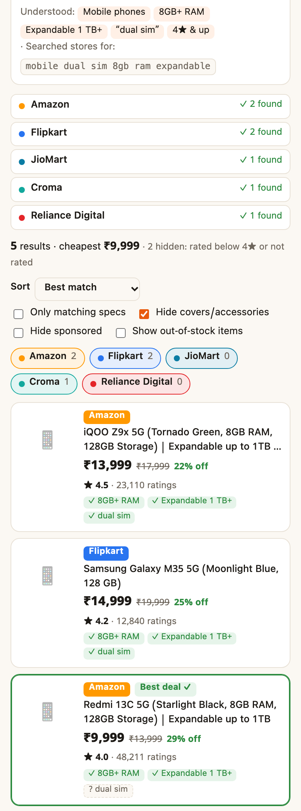
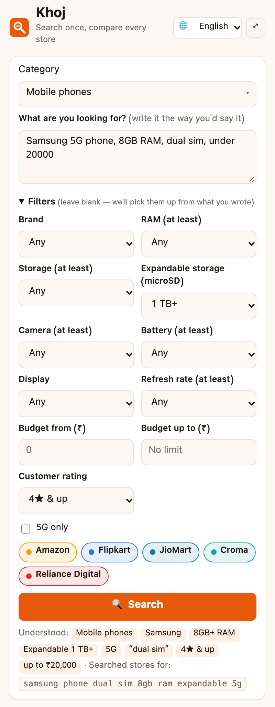

<div align="center">


# खोज (Khoj) — भारतीय शॉपिंग साइट्स के लिए प्राइस एग्रीगेटर

**एक बार लिखें कि क्या चाहिए — Amazon, Flipkart, JioMart, Croma और Reliance Digital के नतीजे एक साथ, कीमत के हिसाब से।**

[English](README.md) · [हिन्दी](README.hi.md)


</div>

---

## यह क्या करता है?

फ़ोन, फ्रिज या डायपर ख़रीदने के लिए आमतौर पर पाँच टैब खोलने पड़ते हैं, हर साइट पर अलग से वही खोज करनी पड़ती है, और फिर कीमतें मिलानी पड़ती हैं। खोज यह सब आपके लिए करता है:

> *"Samsung 5G phone, 8GB RAM, 128GB, 50MP camera, 20000 तक"*

लिखिए, और आपको **एक लिस्ट मिलती है, कीमत के हिसाब से sort की हुई**। हर नतीजे पर दिखता है कि आपकी कौन-सी spec मिली।

सब कुछ आपके browser के अंदर चलता है। कोई server नहीं, कोई account नहीं, कोई tracking नहीं।

## ख़ूबियाँ

- 🗣️ **अपनी भाषा में लिखें:** English, Hinglish या हिंदी, किसी में भी। जैसे `15k-25k`, `20000 तक`, `8/256`, `300 लीटर 3 star`, `1.5 ton split`।
- 🛒 **5 साइट्स एक साथ:** Amazon, Flipkart, JioMart, Croma और Reliance Digital।
- 🗂️ **55 कैटेगरी (14 ग्रुप), 140 फ़िल्टर:** हर कैटेगरी के अपने फ़िल्टर हैं। फ़ोन के लिए RAM, स्टोरेज और microSD वाला एक्सपैंडेबल स्टोरेज, फ्रिज के लिए लीटर, दरवाज़े और स्टार रेटिंग, ड्रिल के लिए cordless और वोल्टेज, डायपर के लिए साइज़ और पैक।
- ⭐ **ग्राहक रेटिंग फ़िल्टर:** सिर्फ़ 3★, 3.5★, 4★ या 4.5★ और ऊपर वाले items दिखाएँ। इसे बदलते ही नतीजे तुरंत छँट जाते हैं, दोबारा खोजने की ज़रूरत नहीं। लिखे हुए से भी समझ लेता है, जैसे `4 star and above`, `rating 4.5+`, `highly rated`।
- 🔎 **टाइप करते ही सुझाव:** `mob` → मोबाइल फ़ोन, `fri` → फ्रिज। कैटेगरी न चुनें तो लिखे हुए से अपने-आप पहचान लेता है। जो साइट्स वह कैटेगरी नहीं बेचतीं, उन्हें अपने-आप हटा देता है।
- ↕️ **Sort और फ़िल्टर:** कीमत (कम से ज़्यादा या उल्टा), best match, rating, सबसे ज़्यादा छूट। सिर्फ़ आपकी specs से मिलने वाले items दिखा सकते हैं, और sponsored, accessories व आउट ऑफ़ स्टॉक items छुपा या दिखा सकते हैं।
- ✅ **Spec badges:** `✓` मिला, `✕` नहीं मिला, `?` लिखा नहीं है। आपके लिखे बाक़ी शब्द, जैसे `dual sim` या model का नाम, भी खोजे जाते हैं और उनका अलग badge दिखता है।
- 🏷️ **Best deal:** जो product stock में है और आपकी सारी specs पूरी करता है, उनमें सबसे सस्ता।
- 🌐 **9 भाषाएँ:** English (default), हिन्दी, मराठी, ગુજરાતી, বাংলা, தமிழ், తెలుగు, ಕನ್ನಡ, ਪੰਜਾਬੀ।
- 🌙 **लाइट और डार्क मोड:** आपके system की setting के हिसाब से।
- 💾 **जहाँ छोड़ा, वहीं से:** आपकी पिछली खोज, फ़िल्टर, भाषा और view settings याद रहती हैं। Panel बंद करके दोबारा खोलने पर आख़िरी नतीजे भी बने रहते हैं।
- 🔒 **निजी:** कुछ भी आपके browser से बाहर नहीं जाता, और Khoj सिर्फ़ इन 5 साइट्स को पढ़ सकता है। ज़्यादा जानकारी [PRIVACY.md](PRIVACY.md) में है।

## Install कैसे करें

1. [**Latest release**](https://github.com/nidhishankermodi/khoj-extension/releases/latest) से `khoj-extension-vX.Y.Z.zip` डाउनलोड करके unzip करें।
2. Chrome में `chrome://extensions` खोलें (Edge में `edge://extensions`, Brave में `brave://extensions`)।
3. ऊपर दाईं ओर **Developer mode** ON करें।
4. **Load unpacked** दबाएँ और unzip किया हुआ folder चुनें (जिसमें `manifest.json` है)।
5. 🧩 मेन्यू से Khoj को pin करें। Icon दबाते ही side panel खुल जाएगा।

Source code से install करना हो तो repo clone करें और Load unpacked में **`extension/`** folder चुनें:

```bash
git clone https://github.com/nidhishankermodi/khoj-extension.git
```

> Chrome 116+ और Side Panel API वाले दूसरे Chromium browsers (Edge, Brave, Opera, Arc) में चलता है। Firefox और Safari अभी supported नहीं हैं।

### नए वर्ज़न पर अपडेट कैसे करें

Unpacked extensions अपने-आप अपडेट नहीं होते। अगर आप extension हटाए बिना उसी folder को अपडेट करें, तो आपकी settings बनी रहती हैं।

- **Release से install किया था:** नई zip डाउनलोड करें और उसे पुराने Khoj folder पर ही unzip करें (फ़ाइलें replace हो जाएँ)। फिर `chrome://extensions` में Khoj के card पर 🔄 **Reload** दबाएँ।
- **Source से install किया था:** अपने clone में `git pull` चलाएँ, फिर 🔄 **Reload** दबाएँ।

हर वर्ज़न में क्या बदला, यह [CHANGELOG.md](CHANGELOG.md) में है। डाउनलोड [Releases](https://github.com/nidhishankermodi/khoj-extension/releases) पेज पर हैं।

## स्क्रीनशॉट

| आपके लिखे शब्द, हर नतीजे पर | फ़ोन के फ़िल्टर | हिन्दी UI |
|:---:|:---:|:---:|
|  |  |  |

<sub>स्क्रीनशॉट में नमूने के नतीजे हैं। उनकी कीमतें और रेटिंग सिर्फ़ उदाहरण के लिए हैं।</sub>

## इस्तेमाल कैसे करें

1. **कैटेगरी चुनें:** कुछ अक्षर टाइप करें, या छोड़ दें। Khoj आपके लिखे से कैटेगरी पहचान लेगा।
2. **लिखें कि क्या चाहिए:** जैसे `मुझे 43 इंच का टीवी चाहिए 25000 तक`, `mujhe 8/256 wala phone chahiye 15k-25k, amoled 120hz` या `samsung phone, expandable up to 1 TB, dual sim, rating 4+`।
3. **चाहें तो फ़िल्टर बदलें:** यहाँ जो चुनेंगे, वह लिखे हुए से ज़्यादा अहमियत रखेगा।
4. **Search** दबाएँ (या <kbd>Ctrl</kbd>/<kbd>⌘</kbd>+<kbd>Enter</kbd>)। नतीजे एक-एक साइट से आते जाते हैं।
5. किसी card पर click करने से product उसी स्टोर की साइट पर खुलता है। <kbd>Ctrl</kbd>/<kbd>⌘</kbd>-click से वह background tab में खुलता है।

## सीमाएँ

- साइट्स अपना HTML बदलती रहती हैं। ऐसा होने पर कोई साइट "कुछ नहीं मिला" दिखा सकती है। तब [issue खोलें](https://github.com/nidhishankermodi/khoj-extension/issues/new?template=site-broken.yml)।
- Captcha आए तो panel में दिए link से एक बार verify करें।
- कीमतें खोज के वक़्त की होती हैं। Bank offers और delivery charges शामिल नहीं होते, इसलिए ख़रीदने से पहले साइट पर ज़रूर देखें।
- रेटिंग फ़िल्टर चालू होने पर बिना रेटिंग वाले items भी छुप जाते हैं, और नतीजों की गिनती में बताया जाता है कि कितने छुपे। कुछ साइट्स अपने search page पर रेटिंग दिखाती ही नहीं।

## योगदान (Contributing)

Pull requests का स्वागत है, ख़ासकर साइट टूटने पर fix, नई कैटेगरी, और native speakers से अनुवाद की जाँच। तरीका [CONTRIBUTING.md](CONTRIBUTING.md) में है।

## डेवलपमेंट

Tests चलाने के लिए Node.js 20 या उससे नया वर्ज़न चाहिए। `npm install` की ज़रूरत नहीं है।

```bash
npm test          # parser और category catalog के unit tests
npm run zip       # dist/khoj-extension-v<version>.zip बनाता है (system का zip tool इस्तेमाल करता है)
```

`extension/` की फ़ाइलें बदलने के बाद `chrome://extensions` पर 🔄 reload दबाएँ। नया release बनाने का तरीका [English README](README.md#releasing) में है।

## अस्वीकरण (Disclaimer)

यह एक स्वतंत्र open-source प्रोजेक्ट है। इसका Amazon, Flipkart, JioMart, Reliance, Croma या किसी भी स्टोर से कोई संबंध नहीं है। सारे ट्रेडमार्क उनके मालिकों के हैं।

Khoj सिर्फ़ आपके browser में, आपके कहने पर, वही public search pages पढ़ता है जो आप ख़ुद खोलते। निजी शॉपिंग के लिए इस्तेमाल करें और साइट्स की शर्तों का सम्मान करें।

## License

[MIT](LICENSE) © 2026 Nidhi Shanker Modi
