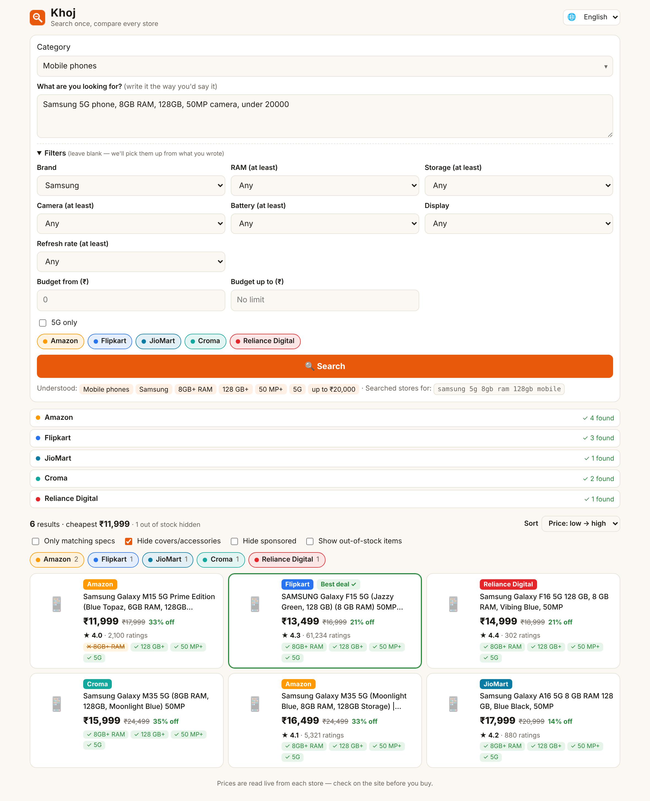
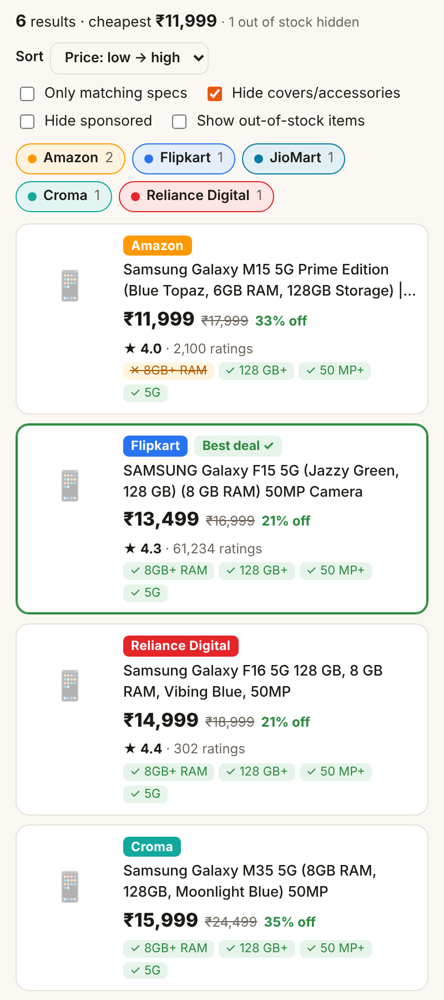
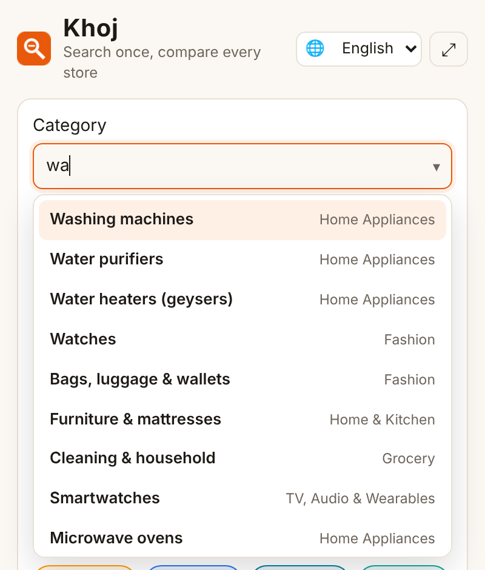
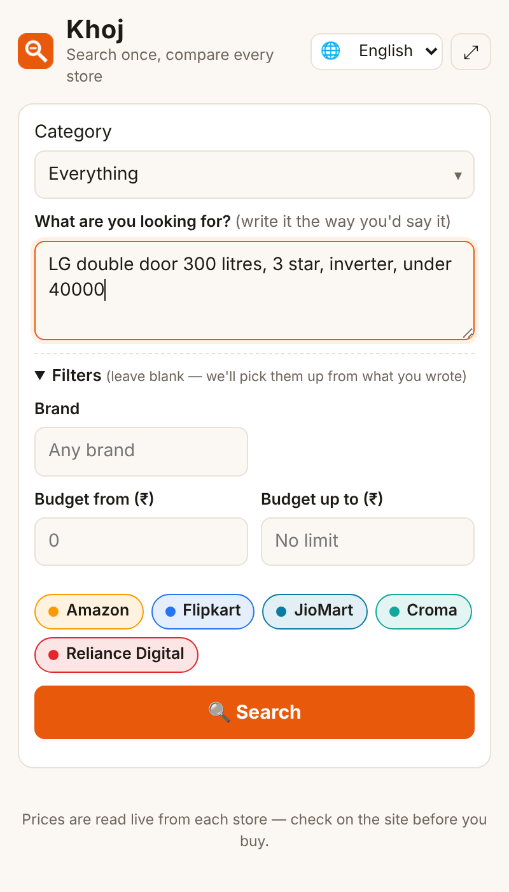
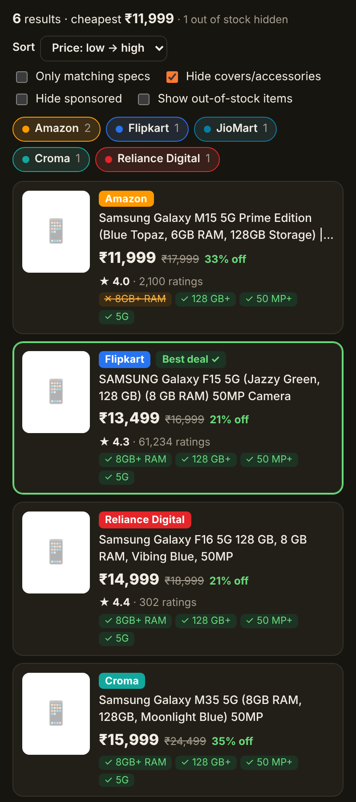
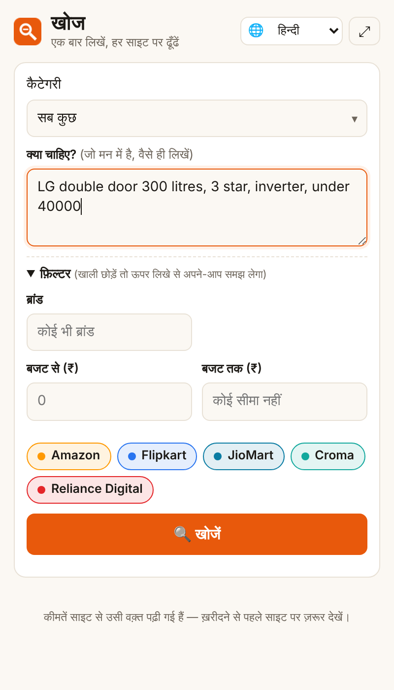
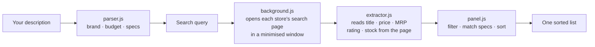

<div align="center">


# Khoj — Price Aggregator for Indian Stores

**Describe what you want once. Compare it across Amazon, Flipkart, JioMart, Croma and Reliance Digital, side by side.**

[](LICENSE)


[](https://github.com/nidhishankermodi/khoj-extension/actions/workflows/ci.yml)

[English](README.md) · [हिन्दी](README.hi.md)



</div>

---

## Why Khoj?

Buying a phone (or a fridge, or diapers) in India usually means opening five tabs, typing the same search five times, and squinting at prices that are each formatted differently. Khoj does that for you:

> *"Samsung 5G phone, 8GB RAM, 128GB, 50MP camera, under 20000"*

…goes in, and you get **one list, sorted by price**. Each result shows which of your specs it matches.

It runs entirely in your browser. No server, no account, no tracking.

## Features

- 🗣️ **Plain-language search.** Write it the way you'd say it, in English, Hinglish or an Indian language. Khoj picks out the brand, budget and specs: `15k-25k`, `20000 तक`, `8/256`, `300 litres 3 star`, `1.5 ton split`, `XL 50 pcs`.
- 🛒 **5 stores at once.** Amazon.in, Flipkart, JioMart, Croma and Reliance Digital.
- 🗂️ **55 categories in 14 groups, 138 smart filters.** Each category gets its own fields:

  | Category | Its filters |
  |---|---|
  | Mobiles | RAM, storage, camera MP, battery mAh, AMOLED/LCD, refresh rate, 5G |
  | Laptops | Processor, RAM, SSD, screen size, gaming / thin & light, OS, dedicated GPU |
  | Refrigerators | Capacity (L), door type, star rating, inverter |
  | Power tools | Tool type, corded/cordless, battery voltage, wattage |
  | Diapers | Pants/taped, size (NB → XXL), pack count |
  | …and 50 more | TVs, ACs, washing machines, footwear, grocery, toys, pet food… |

- 🔎 **Category type-ahead.** Type `mob`, `fri`, `dia` or `tool` to jump to that category. Khoj also detects the category from your description, and unticks stores that don't sell it.
- ↕️ **Sort & filter.** Sort by price (either way), best match, rating or biggest discount. You can show only items that match your specs, hide sponsored items and accessories (no phone covers in your phone search), and show or hide out-of-stock items.
- ✅ **Spec badges.** `✓` matched, `✕` doesn't match, `?` not mentioned in the title. **Best deal** marks the cheapest in-stock item that meets all your specs.
- 🌐 **9 languages.** English (default), हिन्दी, मराठी, ગુજરાતી, বাংলা, தமிழ், తెలుగు, ಕನ್ನಡ, ਪੰਜਾਬੀ.
- 🌙 **Light & dark mode**, following your system setting.
- 💾 **Picks up where you left off.** Your last description, filters, language and view settings are remembered, and the latest results survive closing and reopening the panel.
- 🔒 **Private by design.** Nothing leaves your browser, and Khoj can only read the five store sites. See [PRIVACY.md](PRIVACY.md).

## Screenshots

| Results | Category type-ahead | Category-specific filters |
|:---:|:---:|:---:|
|  |  |  |
| **Dark mode** | **हिन्दी UI** | |
|  |  | |

## Install

```bash
git clone https://github.com/nidhishankermodi/khoj-extension.git
```

Then follow steps 2–5 above and select the **`extension/`** folder.

> Works in Chrome 116+ and other Chromium browsers that support the Side Panel API (Edge, Brave, Opera, Arc). Firefox and Safari are not supported yet.

## How to use

1. **Pick a category.** Type a few letters, or just skip it and Khoj will detect it from your description.
2. **Describe what you want.** Some examples:
   - `oneplus nord under 30000`
   - `mujhe 8/256 wala phone chahiye 15k-25k, amoled 120hz`
   - `dell laptop i5 16gb ram 512gb ssd under 70000`
   - `LG double door fridge 300 litres 3 star inverter`
   - `bosch cordless drill 18v`
   - `pampers pants xl 50 pcs`
   - `मुझे 43 इंच का टीवी चाहिए 25000 तक`
3. **Optionally fine-tune the filters.** Anything you set here overrides what was understood from the text.
4. Press **Search** (or <kbd>Ctrl</kbd>/<kbd>⌘</kbd>+<kbd>Enter</kbd>). Results stream in store by store.
5. **Sort, filter, click.** Each card opens the product page on the store's own site. <kbd>Ctrl</kbd>/<kbd>⌘</kbd>-click opens it in a background tab.

## How it works



- Khoj opens each store's normal **public search page** in a minimised background window, exactly as if you had typed the search yourself. Once the page has loaded, it reads the product cards, then closes the tab.
- The extractor doesn't rely on CSS class names, which change often. Instead it finds **product links**, climbs to the card that contains exactly one product, and reads the `₹` prices, the struck-through MRP, the rating and stock status. Amazon also has a fast path that uses its stable `data-asin` attributes.
- Spec matching is done on the result titles, which is why some badges show `?` (for example, when the title doesn't mention the star rating).

## Known limitations

- **Stores change their HTML.** When one does, that store may return "Nothing found" until the extractor is updated. Please [open an issue](https://github.com/nidhishankermodi/khoj-extension/issues/new?template=site-broken.yml) with the store and your search.
- **Captchas.** If a store shows a robot check, Khoj tells you and gives you a link to open the page and verify. Then search again.
- **Title-based matching.** Specs that aren't in the product title can't be verified from the search page (shown as `?`).
- **Prices are a snapshot.** They're read at the moment you search. Always confirm on the store before buying, including bank offers and delivery charges, which Khoj doesn't include.
- **First-page results only**, up to 40 per store.

## Project structure

```
khoj-extension/
├── extension/            ← load this folder in Chrome
│   ├── manifest.json     Manifest V3 config
│   ├── background.js     Runs a search: opens tabs, injects the extractor, collects results
│   ├── extractor.js      Injected into each store page; reads the product cards
│   ├── sites.js          Store list: search URL + product-link pattern
│   ├── categories.js     55 categories: filters, brands, synonyms, which stores sell them
│   ├── parser.js         Understands your description; matches specs; builds the query
│   ├── i18n.js           UI text in 9 languages
│   ├── panel.html/css/js Side-panel UI
│   └── icons/
├── tests/                Unit tests for the parser & category catalog (node --test)
├── scripts/zip.mjs       Packs extension/ into dist/khoj-extension-v<version>.zip
├── docs/screenshots/
├── .github/              CI, release automation, issue templates
├── CHANGELOG.md
├── CONTRIBUTING.md
└── PRIVACY.md
```

No build step and no dependencies. It's plain JavaScript (ES modules).

## Development

You need Node.js 20 or newer to run the tests. There's nothing to `npm install`.

```bash
npm test          # unit tests for the parser and category catalog
npm run zip       # builds dist/khoj-extension-v<version>.zip (uses the system zip tool)
```

After editing files in `extension/`, click the 🔄 reload icon on `chrome://extensions` to pick up the changes.

**Releasing.** Bump `version` in `extension/manifest.json` and `package.json`, add an entry to [CHANGELOG.md](CHANGELOG.md), then push a tag that matches the manifest version:

```bash
git tag v1.2.0
git push origin v1.2.0
```

The release workflow checks that the tag matches the manifest, runs the tests, builds the zip and publishes a GitHub Release with the zip attached.

## Contributing

Contributions are very welcome, especially **fixes when a store changes its layout**, **new categories**, and **translation reviews** by native speakers. See [CONTRIBUTING.md](CONTRIBUTING.md) for:

- adding a new store
- adding a category or filter
- adding or improving a language
- running the tests

## Roadmap

- [ ] More stores (Vijay Sales, Tata CLiQ, Myntra, Nykaa, BigBasket)
- [ ] Price history & price-drop alerts
- [ ] Merge the same product across stores into one row
- [ ] Firefox support
- [ ] Chrome Web Store listing

## Disclaimer

Khoj is an independent, open-source project. It is **not affiliated with, endorsed by, or sponsored by** Amazon, Flipkart, JioMart, Reliance Retail, Croma (Infiniti Retail) or any other store. All product names, logos and trademarks belong to their respective owners.

Khoj only reads publicly visible search-result pages, in the user's own browser, at the user's request, at the same pace a person would browse. It does not bypass logins, paywalls or captchas, and it does not collect or resell data. Please use it for personal shopping and respect each store's terms of use.

## License

[MIT](LICENSE) © 2026 Nidhi Shanker Modi
